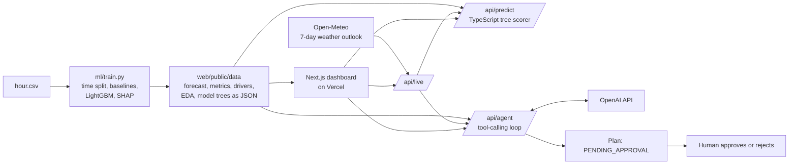

# CityCycle: hourly bike-demand forecasting with AI planning agents

Forecasts hourly bike-share demand for a city operator, explains what drives it, and uses OpenAI-powered agents to turn the forecast into a dispatch plan that a person approves.

Data: UCI Bike Sharing Dataset (`hour.csv`, 17,379 hourly rows, 2011 to 2012).

## Problem statement

A bike-share operator has empty docks at 8am and full docks at 6pm. Trucks rebalance bikes between docks, but without a trustworthy demand forecast they move bikes too late or to the wrong place. Ops asked for:

1. An hourly demand forecast for a period the model has not seen.
2. An honest error number compared with a naive baseline.
3. A one-page guidance: the three biggest demand drivers and what ops should do about each.

## Solution overview

| Piece | What it does |
|---|---|
| `ml/train.py` | Cleans the data, splits by time, compares two baselines and three models, picks gradient boosting, and exports forecasts, metrics, driver importances and the model as JSON trees. |
| `web/` (Next.js) | Dashboard: forecast chart, ops guidance, live what-if predictor, AI agents, data checks. |
| `/api/predict` | Scores the exported LightGBM trees in TypeScript. No Python runtime on Vercel, so no heavy cold start. |
| `/api/ops`, `/api/live`, `/api/predict` | The live pages. `/api/ops` builds the Ops guidance page from the live outlook; `/api/predict` runs what-if scenarios on top of today's live forecast. |
| `/api/live` | Fetches the 7-day weather outlook for Washington, D.C. from Open-Meteo (free, no key, cached 15 minutes), maps it to the model's inputs (temperature, humidity, wind, weather type, day type, US/DC holidays) and returns the predicted rentals for every hour. |
| `/api/agent` | OpenAI tool-calling agents: an **Ops planner** and a **forecast explainer**. Every number they quote comes from tools that read the forecast. Plans are marked `PENDING_APPROVAL`; a person approves or rejects. |

### Results (held-out Jul to Dec 2012, trained on Jan 2011 to Jun 2012)

| Model | MAE (bikes/hour) | RMSE | R² |
|---|---|---|---|
| Average demand (baseline) | 177.4 | 236.1 | -0.15 |
| Same hour last week (baseline) | 63.9 | 109.1 | 0.75 |
| Ridge regression | 101.1 | 135.3 | 0.62 |
| Random forest | 45.9 | 71.5 | 0.89 |
| **Gradient boosting (used)** | **44.3** | **67.8** | **0.905** |

The champion misses by about 44 bikes per hour, 31% better than copying last week. Top drivers (mean absolute SHAP): hour of day 42%, growth trend 18%, temperature 13%, working day 8%.

**Live pages vs the report.** Only the Forecast page shows historical test statistics. Ops guidance, What-if and AI agents run on the live weather outlook. The historical analysis (demand patterns, driver shares, model comparison, error by hour, data checks) is in `docs/CityCycle_Model_Report.pdf` (generated locally with `python ml/make_report.py`; not committed to the repo).

### Data traps found and handled

1. **Target leakage.** `casual + registered = cnt`. A model that sees either scores R² 0.997 and is useless. Both are dropped, along with `instant` (row index), `dteday` (replaced by calendar features) and `atemp` (collinear with `temp`).
2. **Time split.** A random split reports MAE 22.7 (R² 0.96) because neighbouring hours sit in train and test. We train on the past and test on the months after.

### Guardrails for the agents

- The model forecasts; the agent reasons. Forecast figures in a plan are overwritten from the forecast data, never taken from the LLM text.
- The planner is told not to state truck counts or crew sizes, since the data does not contain them.
- Rule-based fallback plan if the key is missing or the API fails, so the demo never breaks.
- Approving a plan records a decision in the UI only. Nothing is dispatched.
- In-memory rate limit, capped tokens and capped input length on the public endpoint.

## Architecture



## Technology stack

- **ML:** Python 3.12, pandas, scikit-learn, LightGBM (native SHAP contributions)
- **App:** Next.js 15 (App Router), React 19, TypeScript, hand-written SVG charts
- **AI agents:** OpenAI Chat Completions with function calling (model set by `OPENAI_MODEL`, default `gpt-4o-mini`)
- **Live weather:** Open-Meteo forecast API (no key; free for non-commercial use, CC BY 4.0 data)
- **Hosting:** Vercel

## Setup and installation

Requires Node 20+ and Python 3.10+.

```bash
# 1. Train and export artifacts (already committed in web/public/data; rerun to refresh)
pip install -r ml/requirements.txt
python ml/train.py

# 2. Run the app
cd web
npm install
cp .env.example .env.local     # add your OPENAI_API_KEY
npm run dev                    # http://localhost:3000
```

If `OPENAI_API_KEY` is already set as a system environment variable, it takes precedence over `.env.local`. Clear or overwrite it if the planner reports an OpenAI error.

### Truck log (Supabase)

Drivers open the **Truck log** page, type how many bikes they just moved, and press one button. The app fills in everything else from the live weather outlook and the calendar: local date and hour, season, month, weekday, holiday, working day, weather type, temperature, humidity, wind, and what the model forecast for that hour. Rows are stored in Supabase in the same layout as `hour.csv` (temperature, humidity and wind are normalized the same way).

- Schema and security rules: [`supabase/truck_log.sql`](supabase/truck_log.sql). Row-level security is on. The server's publishable key can add and read entries but cannot edit or delete them, and the table rejects entries below 1 bike.
- `truck_log_hourly` is a view with one row per date and hour, shaped like `hour.csv`.
- Set `SUPABASE_URL` and `SUPABASE_PUBLISHABLE_KEY` (server-side only, never `NEXT_PUBLIC_`). On a public deployment also set `CREW_ACCESS_CODE`, so only crews who know the code can write entries.
- **What this data is and is not.** `bikes_moved` counts bikes that trucks carried (rebalancing). It is not rentals, so it cannot be used as the training target `cnt`. It is useful for comparing what crews actually moved against what the planner recommended, and for joining with real rental counts from the operator's trip system when those become available.

### Run the model and see its stats from the terminal (VS Code)

The website shows live data only. The historical statistics live in the terminal and in the PDF report.

```bash
python ml/train.py --no-export     # trains the model and prints the stats; does NOT touch the website's data files
python ml/train.py                 # same, and also refreshes web/public/data (the website's model and forecasts)
python ml/make_report.py           # rebuilds docs/CityCycle_Model_Report.pdf from those numbers
```

The terminal output has the model comparison (MAE, RMSE, R-squared), the two data traps, the demand drivers and the error for each hour of the day. Training takes under a minute on a laptop.

## Business benefits

- Ops can pre-position bikes before the 8am and 5 to 6pm working-day peaks instead of reacting to empty docks.
- Staffing and truck runs follow the temperature and weather forecast instead of a fixed schedule.
- Weekends get their own playbook, since the demand shape differs.
- Planning time drops: the agent drafts the dispatch plan and a person only reviews it.
- Trust: error is reported in bikes per hour against baselines, on months the model never saw.

## Future enhancements

- Per-station and per-dock forecasts so trucks get specific destinations (the dataset only has city-wide totals).
- Live rental data and a scheduled retrain. The live forecast uses real weather, but the model still learned from 2011 to 2012, so absolute totals reflect the 2012 system size. The shape of each day is more reliable than the counts.
- MLflow tracking and scheduled quarterly retraining to follow demand growth.
- Prediction intervals so the plan can state a range, not a point.
- Optional automatic dispatch behind explicit approval and audit logging.

## Repo layout

```
data/raw/        hour.csv, day.csv, dataset README
ml/              train.py, requirements.txt
web/             Next.js app (app/, components/, lib/, public/data/)
```

Dataset citation: Fanaee-T, H. and Gama, J., "Event labeling combining ensemble detectors and background knowledge", Progress in Artificial Intelligence (2013), doi:10.1007/s13748-013-0040-3.
